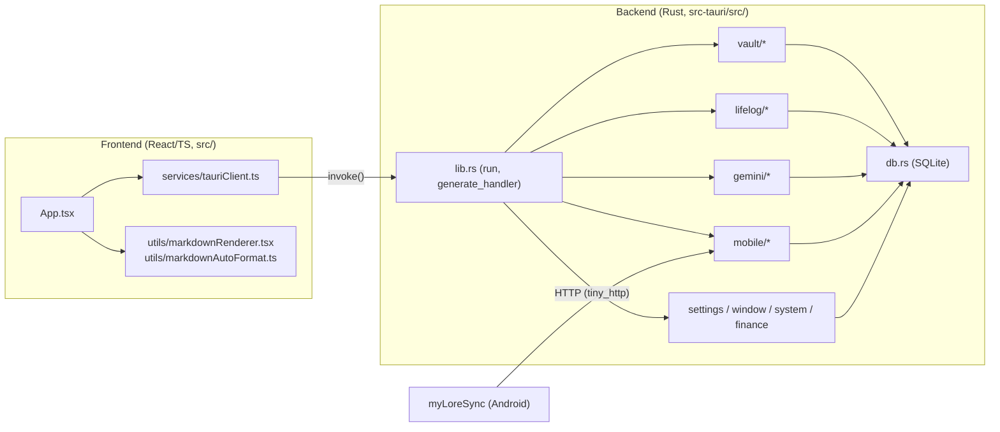

# myLore 코드 지도 (CODEMAP)

> **목적**: 사람과 LLM 에이전트가 grep으로 전체를 훑지 않고 **수정할 파일로 바로 이동**하도록 돕는 색인입니다.
> 기능을 추가하거나 옮겼다면 이 문서도 함께 갱신해 주세요. Rust 섹션은 `pub(crate)`/`#[tauri::command]` 기준으로 자동 생성한 목록을 기반으로 합니다.

## 0. 빠른 탐색 규칙

| 하고 싶은 일 | 먼저 볼 곳 |
|---|---|
| 프론트엔드에서 호출하는 백엔드 API 찾기 | `src/services/tauriClient.ts` 함수 → 같은 이름의 snake_case Rust 커맨드 (아래 2장에서 검색) |
| 새 Tauri 커맨드 추가 | 해당 도메인 모듈에 `#[tauri::command] pub(crate) fn ...` 작성 → `src-tauri/src/lib.rs`의 `generate_handler![]`에 등록 → `tauriClient.ts`에 래퍼 추가 → `src/types/mylore.ts`에 타입 추가 |
| DB 테이블/컬럼 변경 | `src-tauri/src/db.rs` (`create_schema`, `apply_column_migrations`) |
| 앱 설정 항목 추가 | `src-tauri/src/settings.rs` (`MyLoreAppSettings` + `default_*`) ↔ `src/types/mylore.ts` |
| 모바일 동반 앱 HTTP 엔드포인트 | `src-tauri/src/mobile/http_server/mod.rs` (URL → `handle_*` 라우팅 표) → `routes_core.rs` / `routes_sync.rs` / `routes_media.rs` |
| 동기화 큐 작업 처리 | `src-tauri/src/mobile/sync_worker/mod.rs` (`SyncWorkerJob`, 배치 루프) → `jobs_messages.rs` / `jobs_meta.rs` / `jobs_files.rs` |
| Gemini 호출/프롬프트 | `src-tauri/src/gemini/client.rs` |
| 스타일 | `src/styles/app.css` (단일 중앙 집중형 CSS 정책) |

## 1. 전체 구조

**백엔드 모듈 규칙**
- 모든 모듈은 첫 줄 `use crate::*;` 로 공용 네임스페이스(외부 crate import + 모든 모듈의 `pub(crate)` 항목)를 공유합니다. 기존 단일 파일(`lib.rs`)을 동작 변경 없이 분리하기 위한 방식입니다.
- 새 코드는 가능하면 명시적 `use crate::db::open_db;` 형태를 권장합니다.
- 파일 하나는 **1,000줄 이하**를 목표로 합니다. (현재 백엔드 최대 파일: `vault/documents.rs` 약 750줄)

## 2. 백엔드 (`src-tauri/src/`)

### 2.0 모바일 HTTP 라우팅 표 (`mobile/http_server/mod.rs`)

| URL | 핸들러 | 파일 |
|---|---|---|
| `/api/v1/open-files` | `handle_open_files` | `routes_core.rs` |
| `/api/v1/status`, `/api/v1/sync/watermarks` | `handle_status_and_watermarks` | `routes_core.rs` |
| `/api/v1/sync/batch-init` | `handle_batch_init` | `routes_core.rs` |
| `/api/v1/pair/confirm` | `handle_pair_confirm` | `routes_core.rs` |
| `/api/v1/sync/check-hashes` | `handle_check_hashes` | `routes_core.rs` |
| `/api/v1/sync/notifications` · `sms` · `call-logs` · `kakao-chats` · `contacts` · `app-usage` | `handle_sync_*` | `routes_sync.rs` |
| `/api/v1/sync/call-recordings` · `media` · `samsung-health` | `handle_sync_*` | `routes_media.rs` |
| `/api/v1/local-media` | `handle_local_media` | `routes_media.rs` |
| 그 외 (Chrome App Mode 정적 파일) | `handle_static_or_fallback` | `routes_media.rs` |

동기화 라우트는 요청을 파싱해 `enqueue_sync_worker_job()`으로 큐에 넣고, 실제 디스크/DB 반영은 `sync_worker/jobs_*.rs`의 `handle_*_job`이 배치 트랜잭션 안에서 처리합니다.

### `src-tauri/src/db.rs` (236줄)

SQLite 메타 DB 연결, 스키마 생성/마이그레이션 및 `mobile_sync_meta` 키-값 헬퍼.

- **함수**: `open_db`, `create_schema`, `apply_column_migrations`, `seed_default_meta_and_base_folders`, `get_meta_i64`, `set_meta_i64_max`
- **전역 상태**: `DB_SCHEMA_INITIALIZED`, `LIFELOG_BACKFILLED_ONCE`

### `src-tauri/src/finance.rs` (293줄)

가계부: 금융 거래 조회, 알림 문자 파싱, 엑셀 행 가져오기.

- **커맨드**: `get_all_finance_transactions`, `parse_notification_into_finance`, `import_finance_rows`
- **함수**: `try_insert_finance_from_mobile_text`

### `src-tauri/src/gemini/client.rs` (599줄)

Gemini API 클라이언트: API 키/토큰 사용량 저장, 모델 폴백, 음성 → 텍스트 변환, 쿼터 상태.

- **함수**: `resolve_local_appdata_gemini_key_path`, `read_local_gemini_api_key_full`, `read_local_gemini_api_key`, `resolve_local_appdata_gemini_usage_path`, `record_gemini_token_usage`, `read_gemini_token_usage`, `is_auto_call_transcription_enabled`, `mask_gemini_api_key`, `extract_recommended_model_from_error`, `discover_available_gemini_model`, `call_gemini_generate_content_single_model`, `call_gemini_generate_content_with_model`, `call_gemini_generate_content`, `transcribe_call_audio_with_gemini`, `transcribe_voice_recording_with_gemini`, `record_gemini_quota_exhaustion`, `clear_gemini_quota_exhaustion`, `build_gemini_api_key_status_with_conn`

### `src-tauri/src/gemini/transcription.rs` (707줄)

통화 녹음 자동 스크립트화 워커 및 Gemini 관련 Tauri 커맨드.

- **커맨드**: `retry_pending_call_transcriptions`, `get_gemini_api_key_status`, `set_auto_call_transcription`, `transcribe_single_call_item`, `save_and_verify_gemini_api_key`, `transcribe_local_audio_file`
- **함수**: `process_pending_call_transcriptions`, `spawn_call_transcript_retry_worker`
- **전역 상태**: `IS_TRANSCRIPTION_RUNNING`

### `src-tauri/src/lib.rs` (190줄)

myLore Tauri 백엔드 크레이트 루트.

- **함수**: `run`

### `src-tauri/src/lifelog/backfill.rs` (529줄)

`mobile/*.md` 아카이브 → 라이프로그 DB 백필(재색인).

- **함수**: `backfill_mobile_md_into_lifelog_db`

### `src-tauri/src/lifelog/commands.rs` (602줄)

라이프로그 조회/열기 Tauri 커맨드.

- **커맨드**: `get_lifelog_for_date`, `open_lifelog_item_document`, `get_all_lifelog_messages`

### `src-tauri/src/lifelog/contacts.rs` (76줄)

휴대폰 연락처 매핑(전화번호 → 표시 이름).

- **커맨드**: `get_mobile_contacts_map`
- **함수**: `normalize_phone_digits`, `load_mobile_contacts_map`, `resolve_contact_display`

### `src-tauri/src/lifelog/kakao.rs` (443줄)

카카오톡 대화 마크다운: 가져오기, 병합 마이그레이션, 미디어 보강, 멀티파트 파싱.

- **커맨드**: `import_kakao_chat_text`
- **함수**: `migrate_raw_kakao_chat_mds`, `enrich_kakao_markdown_with_media`, `parse_multipart_kakao_payload`, `upsert_kakao_metadata_in_md`

### `src-tauri/src/lifelog/parse.rs` (530줄)

문자/녹음 파일명·본문 파서 및 LLM 응답(요약/스크립트) 정규화. (순수 함수 위주)

- **함수**: `strip_multipart_prefix_if_present`, `clean_mms_and_multiline_body`, `is_voice_memo_or_watch_recording`, `parse_voice_recording_filename_meta`, `extract_clean_contact_name`, `parse_call_audio_filename_meta`, `normalize_script_lines_with_timestamps_and_clean_name`, `split_summary_and_transcript`

### `src-tauri/src/lifelog/parse_tests.rs` (232줄)

`lifelog::parse` / `lifelog::contacts` 순수 함수 단위 테스트 (15개).

### `src-tauri/src/lifelog/recordings.rs` (666줄)

통화/음성 녹음 마크다운 작성, 라이프로그 DB 반영, 녹음 파일 탐색·재생 정보.

- **커맨드**: `get_call_recording_play_info`
- **함수**: `write_call_recording_markdown`, `write_voice_recording_markdown`, `upsert_single_recording_into_lifelog_db`, `repair_multipart_audio_file_if_needed`, `normalize_call_contact_key`, `find_call_audio_and_md`, `find_call_audio_and_md_ext`

### `src-tauri/src/mobile/auth.rs` (220줄)

동반 앱 HTTP 요청 인증(페어링 토큰)·기기 식별·JSON 응답 헬퍼.

- **함수**: `respond_json`, `resolve_request_device`, `check_request_token`, `check_request_token_fast`, `extract_request_device_headers`
- **전역 상태**: `LAST_SEEN_DB_UPDATE_MS`, `CACHED_PAIRING_TOKEN`

### `src-tauri/src/mobile/health.rs` (282줄)

삼성 헬스 동기화 페이로드 처리.

- **함수**: `process_samsung_health_sync_payload`

### `src-tauri/src/mobile/http_server/mod.rs` (75줄)

모바일 동반 앱용 로컬 HTTP 서버(tiny_http, 포트 18443).

- **함수**: `spawn_mobile_companion_http_server`

### `src-tauri/src/mobile/http_server/routes_core.rs` (406줄)

동반 앱 HTTP 라우트: 파일 열기 전달, 상태/워터마크, 배치 시작, 페어링 확정, 해시 중복 확인.

- **함수**: `handle_open_files`, `handle_status_and_watermarks`, `handle_batch_init`, `handle_pair_confirm`, `handle_check_hashes`

### `src-tauri/src/mobile/http_server/routes_media.rs` (462줄)

동반 앱 HTTP 라우트: 통화 녹음/미디어/삼성 헬스 수신, 로컬 미디어 서빙, 정적 파일(Tauri `asset_resolver` 내장 에셋 fallback).

- **함수**: `handle_sync_call_recordings`, `handle_sync_media`, `handle_sync_samsung_health`, `handle_local_media`, `handle_static_or_fallback`

### `src-tauri/src/mobile/http_server/routes_sync.rs` (544줄)

동반 앱 HTTP 라우트: 알림/문자/통화기록/카톡/연락처/앱 사용량 동기화 수신 → 워커 큐 적재.

- **함수**: `handle_sync_notifications`, `handle_sync_sms`, `handle_sync_call_logs`, `handle_sync_kakao_chats`, `handle_sync_contacts`, `handle_sync_app_usage`

### `src-tauri/src/mobile/pairing.rs` (328줄)

모바일 동반 앱 페어링: 로컬 IP 탐지, 현재 연결된 Wi-Fi SSID 자동 탐지(`netsh wlan show interfaces`), UDP 깨우기, 페어링 정보/설정 커맨드.

- **커맨드**: `send_mobile_udp_wake_broadcast`, `get_mobile_pairing_info`, `remove_paired_mobile_device`, `trigger_full_mobile_resync`, `update_mobile_pairing_config`
- **함수**: `detect_local_ipv4_addresses`, `broadcast_udp_pc_online`, `detect_current_wifi_ssids`, `parse_netsh_wlan_ssids`, `merge_ssids`, `build_mobile_pairing_payload`

### `src-tauri/src/mobile/pairing_tests.rs` (41줄)

`mobile::pairing` 순수 함수 단위 테스트 (3개).

### `src-tauri/src/mobile/progress.rs` (353줄)

모바일 동기화 진행률 상태(인메모리) 및 프론트엔드 이벤트 발행.

- **커맨드**: `get_mobile_sync_progress_state`, `trigger_sequential_mobile_sync`
- **함수**: `rebuild_step_segments`, `default_live_sync_progress`, `emit_live_service_sync_progress`, `complete_all_remaining_sync_steps`
- **타입**: `MobileSyncSegment`, `MobileSyncStepSummary`, `MobileSyncProgressPayload`
- **전역 상태**: `LIVE_SYNC_PROGRESS`, `SYNC_QUEUE_DEPTH`, `IS_WORKER_ACTIVE`, `LAST_PROGRESS_EMIT_MS`, `INITIAL_SYNC_CHECKED`, `LAST_APP_USAGE_DIGEST`

### `src-tauri/src/mobile/storage.rs` (148줄)

모바일 아카이브 폴더(`mobile/*`) 경로·마크다운 append 및 인메모리 중복 방지 캐시.

- **함수**: `get_archive_mobile_dir`, `append_lines_to_mobile_md_batch`, `append_line_to_mobile_md`, `reset_in_memory_sync_caches`, `mark_hash_synced_in_memory`, `is_hash_synced_in_memory`
- **전역 상태**: `CACHED_DATA_BASE_PATH`, `MEM_LAST_KAKAO_TS`, `MEM_LAST_SMS_TS`, `MEM_LAST_CALL_TS`, `MEM_LAST_NOTI_TS`, `MEM_LAST_RECORDING_TS`, `MEM_LAST_HEALTH_TS`, `MEM_LAST_CONTACT_TS`, `MEM_LAST_USAGE_TS`, `PENDING_SYNCED_HASHES`

### `src-tauri/src/mobile/sync_worker/jobs_files.rs` (217줄)

동기화 워커 작업: 통화 녹음 / 미디어 파일 저장.

- **함수**: `handle_call_recording_job`, `handle_media_job`

### `src-tauri/src/mobile/sync_worker/jobs_messages.rs` (533줄)

동기화 워커 작업: 알림 / 문자 / 통화 기록 / 카카오톡 대화 병합.

- **함수**: `handle_notifications_job`, `handle_sms_job`, `handle_call_logs_job`, `handle_kakao_chat_job`

### `src-tauri/src/mobile/sync_worker/jobs_meta.rs` (102줄)

동기화 워커 작업: 연락처 / 앱 사용량 (백그라운드 메타데이터).

- **함수**: `handle_contacts_job`, `handle_app_usage_job`

### `src-tauri/src/mobile/sync_worker/mod.rs` (341줄)

백그라운드 동기화 작업 큐(`SyncWorkerJob`)와 워커 스레드.

- **함수**: `enqueue_sync_worker_job`, `spawn_mobile_sync_worker_thread`
- **타입**: `SyncWorkerJob`
- **전역 상태**: `SYNC_WORKER_TX`

### `src-tauri/src/models.rs` (330줄)

프론트엔드와 주고받는 공용 직렬화 모델(DTO) 모음.

- **타입**: `ScanProgressPayload`, `TrashedFileRecord`, `DetachedPreviewState`, `DetachedPreviewActionPayload`, `DetachedScrollPayload`, `BaseFolderConfig`, `FileNode`, `BacklinkItem`, `DocumentPayload`, `BatchScanSummary`, `LifelogMessage`, `FinanceTransaction`, `MediaInboxItem`, `CreateDocParams`, `SearchMatchItem`, `VaultTemplateItem`, `FinanceImportRow`, `FinanceImportSummary`, `KakaoImportResult`, `DailyLifelogResponse`, `PairedDeviceItem`, `MobilePairingPayload`, `GeminiApiKeyStatus`, `CallPlayInfoPayload`

### `src-tauri/src/paths.rs` (147줄)

앱 경로 해석: 메타 DB(`%APPDATA%\com.iseohyun.mylore\mylore_meta.db`), 기본 베이스 폴더(`%USERPROFILE%\Documents\myLore\*`), 레거시 OneDrive DB 1회 `VACUUM INTO` 이전.

- **함수**: `env_dir`, `app_data_dir`, `meta_db_path`, `default_user_root`, `default_data_base_dir`, `default_projects_base_dir`, `projects_base_path_string`, `data_base_path_string`, `legacy_meta_db_candidates`, `resolve_meta_db_path`, `migrate_meta_db`

### `src-tauri/src/paths_tests.rs` (81줄)

`paths` 단위 테스트: 레거시 메타 DB(WAL 포함) `VACUUM INTO` 이전 및 기본 경로 검증 (3개).

### `src-tauri/src/settings.rs` (242줄)

앱 설정(`setting.json`) 모델, 기본값 및 조회/저장 커맨드.

- **커맨드**: `get_app_settings`, `save_app_settings`
- **함수**: `default_f11_viewer_mode`, `default_auto_save`, `default_editor_view_mode`, `default_scroll_sync`, `default_base_font_family`, `default_heading_font_family`, `default_table_font_family`, `default_base_font_size`, `default_heading_scale`, `default_table_font_size`, `default_theme_preset`, `default_bg_primary`, `default_bg_secondary`, `default_text_primary`, `default_text_secondary`, `default_heading_color`, `default_accent_primary`, `default_table_header_bg`, `default_table_header_color`, `default_border_color`, `default_auto_call_transcription`, `resolve_projects_setting_json_path`
- **타입**: `MyLoreAppSettings`

### `src-tauri/src/state.rs` (12줄)

Tauri 전역 관리 상태(`AppState`).

- **타입**: `AppState`

### `src-tauri/src/system.rs` (207줄)

OS 연동: 탐색기, 네이티브 파일 대화상자, Chrome/구글 캘린더 실행, CLI 인자·단일 인스턴스.

- **커맨드**: `show_in_explorer`, `open_native_file_dialog`, `open_native_folder_dialog`, `open_in_chrome_app_mode`, `open_google_calendar_web`, `take_pending_cli_files`
- **함수**: `extract_cli_md_paths`, `try_forward_to_existing_instance`

### `src-tauri/src/util.rs` (145줄)

공통 유틸리티 (Windows 프로세스 플래그, `cached_regex!` 정규식 캐시 매크로, base64, URL 디코딩, 시간 변환, 파일명 정리).

- **매크로**: `cached_regex!`
- **함수**: `base64_encode`, `base64_decode`, `epoch_ms_to_local_date_time`, `sanitize_filename_stem`, `update_atomic_max_i64`, `url_decode_utf8`

### `src-tauri/src/vault/documents.rs` (737줄)

문서 읽기/저장/생성/이름변경, 파일 내 검색·치환, 템플릿, 역할 이동.

- **커맨드**: `read_document`, `read_document_by_uuid`, `save_document`, `create_new_document`, `create_temp_memo`, `open_root_main_md`, `rename_current_document`, `search_in_files`, `replace_in_files`, `get_vault_templates`, `promote_to_project_folder`, `move_document_to_role`
- **함수**: `build_document_payload`

### `src-tauri/src/vault/markdown.rs` (204줄)

마크다운 YAML Frontmatter 파싱, UUID 주입, `.myLore` 템플릿 보장.

- **함수**: `is_internal_mylore_path`, `ensure_projects_mylore_templates`, `parse_markdown_yaml`, `ensure_uuid_in_markdown_file`, `parse_frontmatter_and_body_simple`

### `src-tauri/src/vault/scan.rs` (475줄)

베이스 폴더 설정, 일괄 UUID 스캔(진행률), 가상 통합 트리.

- **커맨드**: `get_base_folders`, `save_base_folders`, `get_scan_progress`, `start_batch_uuid_scan`, `scan_and_inject_uuids`, `get_virtual_tree`

### `src-tauri/src/vault/trash.rs` (136줄)

Windows 휴지통 이동 및 휴지통 복원.

- **커맨드**: `trash_document`, `restore_trashed_document`
- **함수**: `move_file_to_windows_recycle_bin`
- **타입**: `SHFILEOPSTRUCTW`

### `src-tauri/src/window.rs` (142줄)

창 제어: 전체 화면 토글 및 분리(Detached) 미리보기 창 동기화.

- **커맨드**: `toggle_window_fullscreen`, `sync_detached_preview_scroll`, `toggle_detached_preview_window`, `emit_detached_preview_action`, `sync_detached_preview_state`, `get_detached_preview_state`

## 3. 프론트엔드 (`src/`)

| 파일 | 줄 수 | 역할 |
|---|---|---|
| `main.tsx` | 9 | React 진입점 |
| `App.tsx` | ~11,100 | **단일 루트 컴포넌트** (상태 97개, 메뉴·탭·에디터·사이드바·대쉬보드·모달 전부 포함). 분리 예정(Phase 2) |
| `services/tauriClient.ts` | ~830 | Rust 커맨드 `invoke()` 래퍼 58개 + 브라우저(비 Tauri) 환경 폴백 |
| `types/mylore.ts` | ~270 | 백엔드 DTO와 1:1로 대응하는 TS 타입 |
| `utils/markdownRenderer.tsx` | ~840 | `MarkdownPreviewRenderer`, `renderInlineMarkdown`, `scrollPreviewPaneToSourceLine`, `parseAudioOffsetSecondsFromLine` |
| `utils/markdownAutoFormat.ts` | ~260 | YAML 분리/결합, 할 일(Task) 추출·상태 변경, TOC 추출, `GOOGLE_CALENDAR_COLOR_MAP` |
| `styles/app.css` | ~1,400 | 전역 스타일 (디자인 토큰·레이아웃·컴포넌트) |
| `version.ts` | 2 | 버전 상수 |

### 3.1 `App.tsx` 내부 지도 (검색 키워드 기준)

줄 번호는 바뀔 수 있으니 **따옴표 안의 주석 문자열로 검색**하세요.

| 영역 | 검색 키워드 | 대략 위치 |
|---|---|---|
| 단축키 기본값 | `DEFAULT_KEYBINDINGS` | L137 |
| 분리 미리보기 창 컴포넌트 | `function DetachedPreviewWindowView` | L196 |
| 루트 컴포넌트 시작 / 상태 선언 | `export default function App` | L411~ |
| 동기화 진행률 이벤트 리스너 | `listen<MobileSyncProgressPayload>('mobile-sync-progress'` | L1555 |
| 상단 헤더·메뉴 | `1. 상단 헤더` | L4250 |
| 문서 탭 바 | `다중 문서 탭 바` | L5233 |
| 메인 바디 | `2. 메인 바디 영역` | L5387 |
| 설정 탭 (QR, 통합 설정 표, Gemini 키) | `탭 1: ⚙️ 설정` | L5810 |
| 휴대폰 데이터 탭 | `탭 2: 📱 휴대폰데이터` | L6406 |
| 금융 테이블 | `필터링된 금융 거래내역 테이블` | L6846 |
| 글꼴/테마/에디터/베이스 폴더 설정 | `2. 글꼴(기본/제목/표)` ~ `6. 베이스 폴더 설정` | L7003~L7912 |
| 찾기/바꾸기, YAML 드로어 | `문서 내 인라인 찾기/바꾸기 바`, `YAML 메타데이터 편집 드로어` | L8063, L8131 |
| 마크다운 에디터 & 뷰어 | `마크다운 에디터 & 라이브 뷰어` | L8286 |
| 우측 사이드바 | `3. 우측 접이식 사이드바` | L8802 |
| 하단 상태 표시줄 / 오디오 재생바 | `4. 하단 상태 표시줄` | L9908 |
| 컨텍스트 메뉴 | `5. 우클릭 컨텍스트 메뉴` | L10056 |
| 모달 (팔레트·새 일정·도움말·줄 이동·베이스 폴더·프로젝트·템플릿) | `6. 명령어 팔레트` ~ `13. 볼트 템플릿 관리 모달` | L10312~ |
