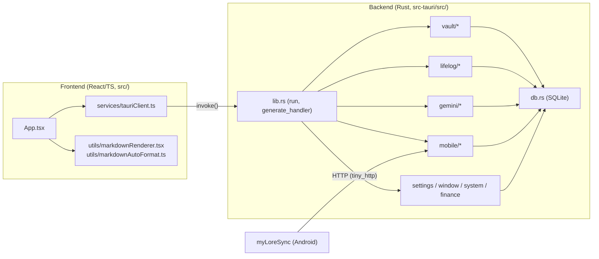

# myLore 코드 지도 (CODEMAP)

> **목적**: 사람과 LLM 에이전트가 grep으로 전체를 훑지 않고 **수정할 파일로 바로 이동**하도록 돕는 색인입니다.
> 기능을 추가하거나 옮겼다면 이 문서도 함께 갱신해 주세요. Rust 섹션은 `pub(crate)`/`#[tauri::command]` 기준으로 자동 생성한 목록을 기반으로 합니다.

## 0. 빠른 탐색 규칙

| 하고 싶은 일 | 먼저 볼 곳 |
|---|---|
| 프론트엔드에서 호출하는 백엔드 API 찾기 | `src/services/tauriClient.ts` 함수 → 같은 이름의 snake_case Rust 커맨드 (아래 2장에서 검색) |
| 새 Tauri 커맨드 추가 | 해당 도메인 모듈에 `#[tauri::command] pub(crate) fn ...` 작성 → `src-tauri/src/lib.rs`의 `generate_handler![]`에 등록 → `tauriClient.ts`에 래퍼 추가 → `src/types/mylore.ts`에 타입 추가 |
| DB 테이블/컬럼 변경 | `src-tauri/src/db.rs` (`create_schema`, `apply_column_migrations`) |
| 앱 설정 항목 추가 | `src-tauri/src/settings.rs` (`MyLoreAppSettings` + `default_*`) ↔ `src/types/mylore.ts` |
| 모바일 동반 앱 HTTP 엔드포인트 | `src-tauri/src/mobile/http_server/mod.rs` (URL → `handle_*` 라우팅 표) → `routes_core.rs` / `routes_sync.rs` / `routes_media.rs` |
| 동기화 큐 작업 처리 | `src-tauri/src/mobile/sync_worker/mod.rs` (`SyncWorkerJob`, 배치 루프) → `jobs_messages.rs` / `jobs_meta.rs` / `jobs_files.rs` |
| Gemini 호출/프롬프트 | `src-tauri/src/gemini/client.rs` |
| 스타일 | `src/styles/app.css` (단일 중앙 집중형 CSS 정책) |

## 1. 전체 구조

**백엔드 모듈 규칙**
- 모든 모듈은 첫 줄 `use crate::*;` 로 공용 네임스페이스(외부 crate import + 모든 모듈의 `pub(crate)` 항목)를 공유합니다. 기존 단일 파일(`lib.rs`)을 동작 변경 없이 분리하기 위한 방식입니다.
- 새 코드는 가능하면 명시적 `use crate::db::open_db;` 형태를 권장합니다.
- 파일 하나는 **1,000줄 이하**를 목표로 합니다. (현재 백엔드 최대 파일: `vault/documents.rs` 약 750줄)

## 2. 백엔드 (`src-tauri/src/`)

### 2.0 모바일 HTTP 라우팅 표 (`mobile/http_server/mod.rs`)

| URL | 핸들러 | 파일 |
|---|---|---|
| `/api/v1/open-files` | `handle_open_files` | `routes_core.rs` |
| `/api/v1/status`, `/api/v1/sync/watermarks` | `handle_status_and_watermarks` | `routes_core.rs` |
| `/api/v1/sync/batch-init` | `handle_batch_init` | `routes_core.rs` |
| `/api/v1/pair/confirm` | `handle_pair_confirm` | `routes_core.rs` |
| `/api/v1/sync/check-hashes` | `handle_check_hashes` | `routes_core.rs` |
| `/api/v1/sync/notifications` · `sms` · `call-logs` · `kakao-chats` · `contacts` · `app-usage` · `location-logs` | `handle_sync_*` | `routes_sync.rs` |
| `/api/v1/sync/call-recordings` · `media` · `samsung-health` | `handle_sync_*` | `routes_media.rs` |
| `/api/v1/local-media` | `handle_local_media` | `routes_media.rs` |
| `/api/v1/voiceprint/mobile-web`, `/api/v1/voiceprint/enroll` | `handle_mobile_voiceprint_web` | `gemini/voiceprint.rs` |
| 그 외 (Chrome App Mode 정적 파일) | `handle_static_or_fallback` | `routes_media.rs` |

동기화 라우트는 요청을 파싱해 `enqueue_sync_worker_job()`으로 큐에 넣고, 실제 디스크/DB 반영은 `sync_worker/jobs_*.rs`의 `handle_*_job`이 배치 트랜잭션 안에서 처리합니다.

### `src-tauri/src/db.rs` (236줄)

SQLite 메타 DB 연결, 스키마 생성/마이그레이션 및 `mobile_sync_meta` 키-값 헬퍼.

- **함수**: `open_db`, `create_schema`, `apply_column_migrations`, `seed_default_meta_and_base_folders`, `get_meta_i64`, `set_meta_i64_max`
- **전역 상태**: `DB_SCHEMA_INITIALIZED`, `LIFELOG_BACKFILLED_ONCE`

### `src-tauri/src/finance.rs` (293줄)

가계부: 금융 거래 조회, 알림 문자 파싱, 엑셀 행 가져오기.

- **커맨드**: `get_all_finance_transactions`, `parse_notification_into_finance`, `import_finance_rows`
- **함수**: `try_insert_finance_from_mobile_text`

### `src-tauri/src/gemini/client.rs` (990줄)

Gemini API 클라이언트: `ureq` (`native-tls-no-default` + `PlatformVerifier` + `x-goog-api-key` 헤더) 인메모리 HTTP 호출, API 키/토큰 사용량 저장, 모델 폴백, 음성 → 텍스트 변환, 쿼터 상태.

- **전역 상태**: `GEMINI_HTTP_AGENT`
- **커맨드**: `get_gemini_api_key_status`, `set_auto_call_transcription`, `save_and_verify_gemini_api_key`, `transcribe_local_audio_file`
- **함수**: `resolve_local_appdata_gemini_key_path`, `read_local_gemini_api_key_full`, `read_local_gemini_api_key`, `resolve_local_appdata_gemini_usage_path`, `record_gemini_token_usage`, `read_gemini_token_usage`, `is_auto_call_transcription_enabled`, `mask_gemini_api_key`, `extract_recommended_model_from_error`, `discover_available_gemini_model`, `call_gemini_generate_content_single_model`, `call_gemini_generate_content_with_model`, `call_gemini_generate_content`, `transcribe_call_audio_with_gemini`, `transcribe_voice_recording_with_gemini`, `record_gemini_quota_exhaustion`, `clear_gemini_quota_exhaustion`, `detect_quota_lock_from_ai_logs`, `build_gemini_api_key_status_with_conn`

### `src-tauri/src/gemini/mod.rs` (401줄)

통화 AI 변환 주간 통계(`get_call_ai_transcription_stats`) 및 의사결재 대시보드용 통화 스크립트 검토 목록(`get_call_approval_items`) 조회 커맨드.

- **커맨드**: `get_call_ai_transcription_stats`, `get_call_approval_items`

### `src-tauri/src/gemini/transcription.rs` (969줄)

통화 녹음 자동 스크립트화 워커 및 멀티 AI 에이전트 순차 배분(`execute_distributed_call_transcription`) Tauri 커맨드.

- **커맨드**: `retry_pending_call_transcriptions`, `transcribe_single_call_item`, `update_call_transcript_stage`
- **함수**: `process_pending_call_transcriptions`, `spawn_call_transcript_retry_worker`, `execute_distributed_call_transcription`, `extract_existing_valid_script_body`, `inject_llm_provider_into_md`
- **전역 상태**: `IS_TRANSCRIPTION_RUNNING`

### `src-tauri/src/gemini/multi_llm.rs` (756줄)

다중 LLM(Anthropic Claude, OpenAI GPT, xAI Grok) API 키·기본 모델·토큰 사용량·쿼터 락·크레딧(`$`) 잔액 관리, xAI Management API(`/v1/billing/teams/{team_id}/prepaid/balance`) 및 Anthropic Admin API(`/v1/organizations/cost_report`) 연동, Round-Robin 에이전트 순차 배분(`pick_next_round_robin_agent`) 및 반려/교정 호출(`run_text_agent_call_script_revision_or_refinement`).

- **커맨드**: `get_multi_llm_providers_status`, `set_active_text_llm_provider`, `save_and_verify_llm_provider_key`, `save_llm_provider_billing_config`
- **함수**: `get_unlocked_available_agents`, `pick_next_round_robin_agent`, `run_text_agent_call_script_revision_or_refinement`, `call_claude_messages_api`, `call_openai_compatible_chat_api`, `fetch_grok_management_prepaid_balance`, `fetch_claude_admin_cost_report`, `estimate_provider_cost_usd`

### `src-tauri/src/gemini/voiceprint.rs` (937줄)

2종 오픈소스 성문 모델(`3D-Speaker CAM++` 192D + `WeSpeaker ResNet34-LM` 256D) 기반 음성지문(Voiceprint) 생성(서버 마이크 & Sync 모바일 연동) 및 Python ONNX 추출기 모듈.

- **커맨드**: `get_voiceprint_dashboard_status`, `enroll_voiceprint_from_base64_audio`, `enroll_voiceprint_from_synced_file`
- **함수**: `resolve_voiceprint_models_dir`, `cosine_similarity_vec`, `l2_normalize_vec`, `load_voiceprint_profile`, `run_dual_model_extractor`, `enroll_audio_into_voiceprint_profile`, `build_voiceprint_dashboard_payload`, `handle_mobile_voiceprint_web`

### `src-tauri/src/gemini/call_ab_review.rs` (970줄)

통화 녹음 단어별 ASR(`faster-whisper`) + 성문 매칭(`### 음성인식엔진`) 및 AI 후처리 재작성(보관·참고 / 기존 후처리 폐기 / 수정+코멘트 반영, 재처리 중 결재 목록 일시 제외 후 완료 시 복귀), 성문 교차검증 테스트(`test_voiceprint_verification`), 음성지문 JSON 직접 편집/초기화(`save_voiceprint_raw_json`, `reset_voiceprint_profile`) 모듈.

- **커맨드**: `analyze_single_call_asr_and_ab`, `reanalyze_recent_pending_approval_calls`, `resolve_call_ab_decision_with_feedback`, `test_voiceprint_verification`, `save_voiceprint_raw_json`, `reset_voiceprint_profile`
- **함수**: `run_call_asr_only_and_preserve_existing`, `run_call_ai_postprocess_from_asr`, `run_call_ai_postprocess_from_asr_ext`, `build_and_save_call_asr_and_ab_scripts`, `reanalyze_recent_pending_approval_calls_internal`

### `src-tauri/src/gemini/postprocess_pipeline.rs` (908줄)

통화 녹음 AI 후처리 프롬프트(`mobile/calls/postprocess_prompt.md`), 사용자 후처리 수정 로그(`mobile/calls/postprocess_user_edit_log.md`) 기록 및 프롬프트 자동 진화, 4단계 상태(`1.다운로드`·`2.ASR처리`·`3.후처리`·`4.확인`) 전환, ASR 부분 재처리(`asr_time_only` / `asr_time_speaker`) 모듈.

- **커맨드**: `get_call_postprocess_prompt_and_log`, `save_call_postprocess_prompt`, `confirm_call_script_with_user_edits`, `update_call_transcript_stage`
- **함수**: `compute_script_diff_entries`, `append_user_postprocess_edit_log_and_evolve_prompt`, `evolve_postprocess_prompt_from_recent_diffs`, `run_call_asr_partial_reprocess`

### `src-tauri/src/lib.rs` (225줄)

myLore Tauri 백엔드 크레이트 루트 (94개 커맨드 등록).

- **함수**: `run`

### `src-tauri/src/lifelog/backfill.rs` (723줄)

`mobile/*.md` 아카이브 → 라이프로그 DB 백필(재색인).

- **함수**: `backfill_mobile_md_into_lifelog_db`

### `src-tauri/src/lifelog/commands.rs` (851줄)

라이프로그 조회/열기 Tauri 커맨드.

- **커맨드**: `get_lifelog_for_date`, `open_lifelog_item_document`, `get_all_lifelog_messages`

### `src-tauri/src/lifelog/contacts.rs` (789줄)

휴대폰 연락처 매핑(전화번호 → 표시 이름), 연락처별 인물 서술(호칭·소속 모임·특징) AI 배경지식 프로필 관리, 최근 상호작용 이벤트 수집(`collect_recent_contact_events_context`), 성문 요약(`build_contact_and_user_voiceprint_summary`) 및 프롬프트 A 통화 음색 섹션 보장(`ensure_prompt_a_phone_voice_section`).

- **커맨드**: `get_mobile_contacts_map`, `get_contact_ai_profiles`, `save_contact_ai_profile`
- **함수**: `normalize_phone_digits`, `load_mobile_contacts_map`, `resolve_contact_display`, `load_contact_ai_profiles_map`, `persist_contact_ai_profiles_to_vault`, `extract_groups_from_profile_text`, `build_contact_ai_context_for_target`, `collect_recent_contact_events_context`, `strip_markdown_code_fence`, `summarize_event_in_one_or_two_lines`, `build_contact_and_user_voiceprint_summary`, `ensure_prompt_a_phone_voice_section`

### `src-tauri/src/lifelog/contact_evolution.rs` (926줄)

연락처 인원별 `.md` 파일(UUID 부여) 생성/관리 및 A/B 프롬프트 경합·자동 진화(사용자 편집 진화 / 3연패 자동 진화 / 의사결재) 모듈.

- **커맨드**: `get_contact_prompt_evolution_state`, `save_contact_prompt_slot`, `sync_all_contacts_to_vault_mds`, `generate_contact_profile_ab_candidates`, `resolve_contact_profile_ab_decision`, `batch_generate_pending_contact_ab_candidates`, `get_approval_center_summary`
- **함수**: `ensure_default_contact_prompt_slots`, `load_prompt_slots`, `evolve_prompt_slot_with_feedback_or_edit`, `sync_all_contacts_to_vault_mds_internal`, `load_all_contact_records`, `generate_ab_candidates_for_contact`

### `src-tauri/src/lifelog/kakao.rs` (781줄)

카카오톡 대화 마크다운: 가져오기, 병합 마이그레이션, 미디어 보강, 멀티파트 파싱, 비즈니스·알림톡 채널 자동 기록 후 알림 삭제, 개인/단톡방 카톡 업데이트 요청 집계 및 해제.

- **커맨드**: `import_kakao_chat_text`, `get_kakao_update_requests`, `resolve_kakao_update_request`
- **함수**: `migrate_raw_kakao_chat_mds`, `enrich_kakao_markdown_with_media`, `parse_multipart_kakao_payload`, `upsert_kakao_metadata_in_md`, `is_kakao_business_or_alimtalk_channel`, `auto_record_kakao_channel_message`, `process_and_consume_kakao_notifications`

### `src-tauri/src/lifelog/parse.rs` (530줄)

문자/녹음 파일명·본문 파서 및 LLM 응답(요약/스크립트) 정규화. (순수 함수 위주)

- **함수**: `strip_multipart_prefix_if_present`, `clean_mms_and_multiline_body`, `is_voice_memo_or_watch_recording`, `parse_voice_recording_filename_meta`, `extract_clean_contact_name`, `parse_call_audio_filename_meta`, `normalize_script_lines_with_timestamps_and_clean_name`, `split_summary_and_transcript`

### `src-tauri/src/lifelog/parse_tests.rs` (232줄)

`lifelog::parse` / `lifelog::contacts` 순수 함수 단위 테스트 (15개).

### `src-tauri/src/lifelog/pc_activity.rs` (467줄)

ActivityWatch(`aw-watcher-window`, `aw-watcher-afk`) 로컬 DB(`peewee-sqlite.v2.db`) 증분 수집 및 일간/주간 PC 활동 통계·타임라인 조회.

- **커맨드**: `get_pc_activity_summary`
- **함수**: `resolve_activitywatch_db_path`, `sync_activitywatch_events_to_mylore`

### `src-tauri/src/lifelog/media_and_location.rs` (665줄)

미디어 원본(origin) SHA-256 해시 레지스트리(`media_origin_registry` — 편집·삭제 후 원본 중복 재수신 방지) 및 모바일 GPS·Wi-Fi 동선 로깅·지도(네이버/구글 지도) 동선 추적 모듈.

- **커맨드**: `get_media_origin_registry_summary`, `update_media_origin_status`, `get_location_movement_logs`, `record_location_movement_entry`
- **함수**: `upsert_media_origin_record`, `is_hash_in_origin_registry`, `reconcile_media_origin_registry_with_disk`, `infer_place_label_from_wifi`, `build_map_tracking_urls`, `insert_location_movement_log`

### `src-tauri/src/lifelog/recordings.rs` (666줄)

통화/음성 녹음 마크다운 작성, 라이프로그 DB 반영, 녹음 파일 탐색·재생 정보.

- **커맨드**: `get_call_recording_play_info`
- **함수**: `write_call_recording_markdown`, `write_voice_recording_markdown`, `upsert_single_recording_into_lifelog_db`, `repair_multipart_audio_file_if_needed`, `normalize_call_contact_key`, `find_call_audio_and_md`, `find_call_audio_and_md_ext`

### `src-tauri/src/mobile/ack_state.rs` (594줄)

동기화 프로토콜 v2.0: `client_ack` 상태 머신(`kakao_room_sync_state`, `domain_sync_state`), 구 프로토콜 누락 카톡 대화방 자동 역추출(Backfill), 세션 플랜(`session-plan`), Background Check(`complete`) 및 클라이언트 수신 확인(`ack`) 핸들러.

- **함수**: `normalize_sync_service_key`, `parse_korean_date_time_to_epoch_ms`, `backfill_sync_ack_states`, `upsert_kakao_room_sync_state_unacked`, `add_kakao_room_media_bytes_unacked`, `mark_domain_sync_state_unacked`, `query_unacked_sync_states`, `handle_session_plan`, `handle_sync_complete`, `handle_sync_ack`

### `src-tauri/src/mobile/auth.rs` (220줄)

동반 앱 HTTP 요청 인증(페어링 토큰)·기기 식별·JSON 응답 헬퍼.

- **함수**: `respond_json`, `resolve_request_device`, `check_request_token`, `check_request_token_fast`, `extract_request_device_headers`
- **전역 상태**: `LAST_SEEN_DB_UPDATE_MS`, `CACHED_PAIRING_TOKEN`

### `src-tauri/src/mobile/health.rs` (282줄)

삼성 헬스 동기화 페이로드 처리.

- **함수**: `process_samsung_health_sync_payload`

### `src-tauri/src/mobile/http_server/mod.rs` (75줄)

모바일 동반 앱용 로컬 HTTP 서버(tiny_http, 포트 18443).

- **함수**: `spawn_mobile_companion_http_server`

### `src-tauri/src/mobile/http_server/routes_core.rs` (652줄)

동반 앱 HTTP 라우트: 파일 열기 전달, 상태/워터마크(현재 NAT Wi-Fi SSID 포함), 동기화 매니페스트/유휴 정합성(`manifest` / `reconcile`), 배치 시작, 페어링 확정, 해시 중복 확인.

- **함수**: `handle_open_files`, `handle_status_and_watermarks`, `handle_sync_manifest_and_reconcile`, `handle_batch_init`, `handle_pair_confirm`, `handle_check_hashes`

### `src-tauri/src/mobile/http_server/routes_media.rs` (462줄)

동반 앱 HTTP 라우트: 통화 녹음/미디어/삼성 헬스 수신, 로컬 미디어 서빙, 정적 파일(Tauri `asset_resolver` 내장 에셋 fallback).

- **함수**: `handle_sync_call_recordings`, `handle_sync_media`, `handle_sync_samsung_health`, `handle_local_media`, `handle_static_or_fallback`

### `src-tauri/src/mobile/http_server/routes_sync.rs` (544줄)

동반 앱 HTTP 라우트: 알림/문자/통화기록/카톡/연락처/앱 사용량 동기화 수신 → 워커 큐 적재.

- **함수**: `handle_sync_notifications`, `handle_sync_sms`, `handle_sync_call_logs`, `handle_sync_kakao_chats`, `handle_sync_contacts`, `handle_sync_app_usage`

### `src-tauri/src/mobile/pairing.rs` (446줄)

모바일 동반 앱 페어링: 로컬 IP 탐지, 서버 시작 시 현재 NAT의 Wi-Fi SSID/비밀번호/인증방식 자동 탐지 및 갱신(`netsh wlan show interfaces`, `Get-NetConnectionProfile`, `netsh wlan show profile ... key=clear`), UDP 깨우기, 페어링 정보/설정 커맨드.

- **커맨드**: `send_mobile_udp_wake_broadcast`, `get_mobile_pairing_info`, `remove_paired_mobile_device`, `trigger_full_mobile_resync`, `update_mobile_pairing_config`
- **함수**: `detect_local_ipv4_addresses`, `broadcast_udp_pc_online`, `detect_current_wifi_ssids`, `refresh_server_nat_wifi_ssids`, `parse_netsh_wlan_ssids`, `merge_ssids`, `detect_wifi_profile_credentials`, `parse_netsh_wlan_profile_credentials`, `build_mobile_pairing_payload`

### `src-tauri/src/mobile/pairing_tests.rs` (78줄)

`mobile::pairing` 순수 함수 단위 테스트 (5개).

### `src-tauri/src/mobile/progress.rs` (420줄)

모바일 동기화 진행률 상태(인메모리) 및 프론트엔드 이벤트 발행.

- **커맨드**: `get_mobile_sync_progress_state`, `trigger_sequential_mobile_sync`
- **함수**: `rebuild_step_segments`, `default_live_sync_progress`, `emit_live_service_sync_progress`, `init_sync_progress_from_db`, `complete_all_remaining_sync_steps`
- **타입**: `MobileSyncSegment`, `MobileSyncStepSummary`, `MobileSyncProgressPayload`
- **전역 상태**: `LIVE_SYNC_PROGRESS`, `SYNC_QUEUE_DEPTH`, `IS_WORKER_ACTIVE`, `LAST_PROGRESS_EMIT_MS`, `INITIAL_SYNC_CHECKED`, `RECONCILE_PENDING_COMPLETION`, `LAST_APP_USAGE_DIGEST`

### `src-tauri/src/mobile/storage.rs` (148줄)

모바일 아카이브 폴더(`mobile/*`) 경로·마크다운 append 및 인메모리 중복 방지 캐시.

- **함수**: `get_archive_mobile_dir`, `append_lines_to_mobile_md_batch`, `append_line_to_mobile_md`, `reset_in_memory_sync_caches`, `mark_hash_synced_in_memory`, `is_hash_synced_in_memory`
- **전역 상태**: `CACHED_DATA_BASE_PATH`, `MEM_LAST_KAKAO_TS`, `MEM_LAST_SMS_TS`, `MEM_LAST_CALL_TS`, `MEM_LAST_NOTI_TS`, `MEM_LAST_RECORDING_TS`, `MEM_LAST_HEALTH_TS`, `MEM_LAST_CONTACT_TS`, `MEM_LAST_USAGE_TS`, `PENDING_SYNCED_HASHES`

### `src-tauri/src/mobile/sync_worker/jobs_files.rs` (217줄)

동기화 워커 작업: 통화 녹음 / 미디어 파일 저장.

- **함수**: `handle_call_recording_job`, `handle_media_job`

### `src-tauri/src/mobile/sync_worker/jobs_messages.rs` (533줄)

동기화 워커 작업: 알림 / 문자 / 통화 기록 / 카카오톡 대화 병합.

- **함수**: `handle_notifications_job`, `handle_sms_job`, `handle_call_logs_job`, `handle_kakao_chat_job`

### `src-tauri/src/mobile/sync_worker/jobs_meta.rs` (102줄)

동기화 워커 작업: 연락처 / 앱 사용량 (백그라운드 메타데이터).

- **함수**: `handle_contacts_job`, `handle_app_usage_job`

### `src-tauri/src/mobile/sync_worker/mod.rs` (341줄)

백그라운드 동기화 작업 큐(`SyncWorkerJob`)와 워커 스레드.

- **함수**: `enqueue_sync_worker_job`, `spawn_mobile_sync_worker_thread`
- **타입**: `SyncWorkerJob`
- **전역 상태**: `SYNC_WORKER_TX`

### `src-tauri/src/models.rs` (330줄)

프론트엔드와 주고받는 공용 직렬화 모델(DTO) 모음.

- **타입**: `ScanProgressPayload`, `TrashedFileRecord`, `DetachedPreviewState`, `DetachedPreviewActionPayload`, `DetachedScrollPayload`, `BaseFolderConfig`, `FileNode`, `BacklinkItem`, `DocumentPayload`, `BatchScanSummary`, `LifelogMessage`, `FinanceTransaction`, `MediaInboxItem`, `CreateDocParams`, `SearchMatchItem`, `VaultTemplateItem`, `FinanceImportRow`, `FinanceImportSummary`, `KakaoImportResult`, `DailyLifelogResponse`, `PairedDeviceItem`, `MobilePairingPayload`, `GeminiApiKeyStatus`, `CallPlayInfoPayload`

### `src-tauri/src/paths.rs` (147줄)

앱 경로 해석: 메타 DB(`%APPDATA%\com.iseohyun.mylore\mylore_meta.db`), 기본 베이스 폴더(`%USERPROFILE%\Documents\myLore\*`), 레거시 OneDrive DB 1회 `VACUUM INTO` 이전.

- **함수**: `env_dir`, `app_data_dir`, `meta_db_path`, `default_user_root`, `default_data_base_dir`, `default_projects_base_dir`, `projects_base_path_string`, `data_base_path_string`, `legacy_meta_db_candidates`, `resolve_meta_db_path`, `migrate_meta_db`

### `src-tauri/src/paths_tests.rs` (81줄)

`paths` 단위 테스트: 레거시 메타 DB(WAL 포함) `VACUUM INTO` 이전 및 기본 경로 검증 (3개).

### `src-tauri/src/settings.rs` (242줄)

앱 설정(`setting.json`) 모델, 기본값 및 조회/저장 커맨드.

- **커맨드**: `get_app_settings`, `save_app_settings`
- **함수**: `default_f11_viewer_mode`, `default_auto_save`, `default_editor_view_mode`, `default_scroll_sync`, `default_base_font_family`, `default_heading_font_family`, `default_table_font_family`, `default_base_font_size`, `default_heading_scale`, `default_table_font_size`, `default_theme_preset`, `default_bg_primary`, `default_bg_secondary`, `default_text_primary`, `default_text_secondary`, `default_heading_color`, `default_accent_primary`, `default_table_header_bg`, `default_table_header_color`, `default_border_color`, `default_auto_call_transcription`, `resolve_projects_setting_json_path`
- **타입**: `MyLoreAppSettings`

### `src-tauri/src/state.rs` (12줄)

Tauri 전역 관리 상태(`AppState`).

- **타입**: `AppState`

### `src-tauri/src/system.rs` (207줄)

OS 연동: 탐색기, 네이티브 파일 대화상자, Chrome/구글 캘린더 실행, CLI 인자·단일 인스턴스.

- **커맨드**: `show_in_explorer`, `open_native_file_dialog`, `open_native_folder_dialog`, `open_in_chrome_app_mode`, `open_google_calendar_web`, `take_pending_cli_files`
- **함수**: `extract_cli_md_paths`, `try_forward_to_existing_instance`

### `src-tauri/src/util.rs` (145줄)

공통 유틸리티 (Windows 프로세스 플래그, `cached_regex!` 정규식 캐시 매크로, base64, URL 디코딩, 시간 변환, 파일명 정리).

- **매크로**: `cached_regex!`
- **함수**: `base64_encode`, `base64_decode`, `epoch_ms_to_local_date_time`, `sanitize_filename_stem`, `update_atomic_max_i64`, `url_decode_utf8`

### `src-tauri/src/vault/documents.rs` (737줄)

문서 읽기/저장/생성/이름변경, 파일 내 검색·치환, 템플릿, 역할 이동.

- **커맨드**: `read_document`, `read_document_by_uuid`, `save_document`, `create_new_document`, `create_empty_document_in_folder`, `create_temp_memo`, `open_root_main_md`, `rename_current_document`, `search_in_files`, `replace_in_files`, `get_vault_templates`, `promote_to_project_folder`, `move_document_to_role`
- **함수**: `build_document_payload`

### `src-tauri/src/vault/markdown.rs` (204줄)

마크다운 YAML Frontmatter 파싱, UUID 주입, `.myLore` 템플릿 보장.

- **함수**: `is_internal_mylore_path`, `ensure_projects_mylore_templates`, `parse_markdown_yaml`, `ensure_uuid_in_markdown_file`, `parse_frontmatter_and_body_simple`

### `src-tauri/src/vault/scan.rs` (475줄)

베이스 폴더 설정, 일괄 UUID 스캔(진행률), 가상 통합 트리.

- **커맨드**: `get_base_folders`, `save_base_folders`, `get_scan_progress`, `start_batch_uuid_scan`, `scan_and_inject_uuids`, `get_virtual_tree`

### `src-tauri/src/vault/trash.rs` (136줄)

Windows 휴지통 이동 및 휴지통 복원.

- **커맨드**: `trash_document`, `restore_trashed_document`
- **함수**: `move_file_to_windows_recycle_bin`
- **타입**: `SHFILEOPSTRUCTW`

### `src-tauri/src/window.rs` (142줄)

창 제어: 전체 화면 토글 및 분리(Detached) 미리보기 창 동기화.

- **커맨드**: `toggle_window_fullscreen`, `sync_detached_preview_scroll`, `toggle_detached_preview_window`, `emit_detached_preview_action`, `sync_detached_preview_state`, `get_detached_preview_state`

### `src-tauri/src/calendar_sync.rs` (760줄)

Google Calendar API v3 양방향 동기화 모듈 (OAuth 2.0 PKCE 로컬 콜백 서버 `127.0.0.1:42813`, 신규 일정 생성 시 자동 업로드, 프로그램 시작 시 및 일정 대쉬보드 `F5` 요청 시 일정 다운로드).

- **커맨드**: `get_google_calendar_sync_status`, `sync_google_calendar_events`, `start_google_calendar_oauth_login`
- **함수**: `resolve_gcal_secret_path`, `load_or_init_gcal_config`, `save_gcal_config`, `ensure_valid_gcal_access_token`, `parse_diary_event_yaml`, `inject_event_id_into_markdown`, `mark_diary_markdown_upload_pending`, `try_upload_diary_markdown_to_gcal`, `sync_google_calendar_events_internal`
- **타입**: `GoogleCalendarSecretConfig`, `ParsedDiaryEventYaml`

## 3. 프론트엔드 (`src/`)

### 3.0 코어 진입점 및 유틸리티 (8개 파일)

| 파일 | 줄 수 | 역할 및 주요 Export 심볼 |
|---|---:|---|
| `main.tsx` | 13 | React 진입점 (`#root` 마운트) |
| `App.tsx` | 271 | 최상위 진입점(`App`: 독립 뷰어 분기) 및 9개 커스텀 훅·24개 하위 컴포넌트를 조합하는 레이아웃 오케스트레이터(`MainApp`). 루트 상태: `openTabs`, `activeTabPath`, `activeTab`, `currentDoc`, `yamlText`, `bodyText`, `isDirty`, `setBodyText`, `setYamlText`, `viewMode`, `rightSidebarOpen`, `rightTab`, `menuBarExpanded`, `activeMenu`, `activeSubMenu`, `paletteMode`, `paletteQuery`, `isFolderPaneFocused`, `contextMenu`, `statusMessage`, `editorRef`, `previewPaneRef`, `lastEditorKeyPressMsRef` |
| `services/tauriClient.ts` | 742 | Rust 커맨드 `invoke()` 래퍼 56개 + 비 Tauri 폴백 (`DEFAULT_BASE_FOLDERS`, `getBaseFolders`, `saveBaseFolders`, `startBatchUuidScan`, `getScanProgress`, `scanAndInjectUuids`, `getVirtualTree`, `readDocument`, `readDocumentByUuid`, `saveDocument`, `createNewDocument`, `createTempMemo`, `openRootMainMd`, `showInExplorer`, `renameCurrentDocument`, `toggleWindowFullscreen`, `searchInFiles`, `replaceInFiles`, `openNativeFileDialog`, `openNativeFolderDialog`, `takePendingCliFiles`, `getVaultTemplates`, `openInChromeAppMode`, `promoteToProjectFolder`, `moveDocumentToRole`, `openExternalUrlInChrome`, `openGoogleCalendarWeb`, `getLifelogForDate`, `getAllFinanceTransactions`, `importFinanceRows`, `parseNotificationIntoFinance`, `importKakaoChatText`, `trashDocument`, `restoreTrashedDocument`, `toggleDetachedPreviewWindow`, `syncDetachedPreviewState`, `getDetachedPreviewState`, `emitDetachedPreviewAction`, `getAppSettings`, `saveAppSettings`, `syncDetachedPreviewScroll`, `getMobilePairingInfo`, `updateMobilePairingConfig`, `removePairedMobileDevice`, `triggerFullMobileResync`, `triggerSequentialMobileSync`, `getMobileSyncProgressState`, `getAllLifelogMessages`, `getMobileContactsMap`, `openLifelogItemDocument`, `retryPendingCallTranscriptions`, `setAutoCallTranscription`, `getCallRecordingPlayInfo`, `transcribeSingleCallItem`, `sendMobileUdpWakeBroadcast`, `getGeminiApiKeyStatus`, `saveAndVerifyGeminiApiKey`, `transcribeLocalAudioFile`) |
| `utils/appearancePresets.ts` | 175 | 글꼴·테마 프리셋 및 CSS 변수 적용 (`FONT_FAMILY_PRESETS`, `THEME_PRESETS`, `DEFAULT_APP_SETTINGS`, `applyAppSettingsToDocument` — `tauriClient.ts`에서도 re-export) |
| `types/mylore.ts` | 374 | 백엔드 DTO 및 프론트엔드 UI 공용 타입 (`ViewMode`, `RightSidebarTab`, `PaletteMode`, `FolderSectionMode`, `ArchiveTreeFolder`, `KeybindingConfig`, `ContextMenuState`, `MobileContextMenuState`, `DirectCallPlayInfo`, `CommandPaletteItem` 등) |
| `utils/markdownRenderer.tsx` | 893 | `MarkdownPreviewRenderer`, `renderInlineMarkdown`, `scrollPreviewPaneToSourceLine`, `parseAudioOffsetSecondsFromLine` |
| `utils/markdownAutoFormat.ts` | 265 | `splitYamlFrontmatter`, `combineYamlAndBody`, `extractTasksFromBody`, `autoFormatMarkdownTasks`, `updateTaskStatusInBody`, `extractTocHeadings`, `GOOGLE_CALENDAR_COLOR_MAP` |
| `utils/editorSearchAndIndent.ts` | 211 | `unescapeReplacePattern`, `applyPatternReplace`, `findMatchesInDocumentBody`, `computeIndentOrOutdent` |
| `styles/app.css` | 3,125 | 단일 중앙 집중형 CSS (파일 상단 L1~20에 14개 섹션별 줄 번호 목차 수록) |

### 3.1 도메인 커스텀 훅 및 반환 심볼 색인 (`src/hooks/` — 9개 파일)

> `App.tsx`에서 `const ctx = { ...baseCtx, ...tree, ...audio, ...docs, ...docActions, ...lifelog, ...editorCmds, ...previewSettings, ...kb }` 형태로 병합되므로, 특정 상태나 핸들러를 찾을 때는 아래 표의 **반환 심볼(Return Keys)**에서 바로 해당 훅 파일을 찾으세요.

| 파일 | 줄 수 | 역할 | 반환 심볼 (Return Keys: State · Ref · Memo · Handler) |
|---|---:|---|---|
| `hooks/useFileTree.ts` | 437 | 가상 파일 트리 조회, 프로젝트/아카이브/Git 트리 구성, 이번 주 일기 및 달력 셀 계산 | **State**: `baseFolders`, `fileTree`, `treeFilter`, `sectionModes`, `openArchiveFolders`, `expandedArchiveMore`, `openProjectFolders`, `subDocFilter`, `subDocViewStyle`, `calendarYearMonth` **Memo/Fn**: `refreshTree`, `flattenedFiles`, `diaryFilesSorted`, `currentWeekRange`, `isTopPriorityProjectNode`, `isThisWeekDiaryNode`, `archiveRootTree`, `projectRootTree`, `gitRootTree`, `currentProjectSubDocs`, `calendarDays` |
| `hooks/useLifelogAudio.ts` | 306 | 통화 녹음 오디오 플레이어 상태, `[00:00:00]` 스크립트 큐 파싱 및 양방향 타임라인 동기화 | **State/Ref**: `directCallPlayInfo`, `activeAudioLineIndex`, `callAudioRef`, `pendingSeekSecondsRef` **Memo/Fn**: `currentDocMobileSource`, `isCurrentDocMobileLifelog`, `isCurrentDocSms`, `isCurrentDocCall`, `isMobileDataSidebarMode`, `loadCallAudioIntoStatusBar`, `audioScriptCues`, `handleAudioTimeUpdate`, `handleSeekAudioTime` |
| `hooks/useDocuments.ts` | 830 | 열린 문서 탭(MRU), 에디터 좌우 수평 분할(`Ctrl+\`) 및 문서 좌/우 에디터 이동(`Ctrl+Alt+←/→`), 자동 저장(1.2s 디바운스), 문서 열기/저장/새 메모/네이티브 다이얼로그 | **State/Ref**: `tabAccessHistory`, `tabAccessHistoryRef`, `isSessionRestoredRef`, `docTabsBarRef`, `editHistoryRef`, `editHistoryIdxRef`, `isNavigatingEditHistoryRef`, `isYamlVisible`, `autoSaveEnabled`, `scanProgress`, `isHorizontalSplitOpen`, `focusedEditorPane`, `leftPaneTabPath`, `rightPaneTabPath`, `rightPaneTabPaths`, `rightPaneViewMode`, `horizontalSplitRatio` **Fn**: `recordEditPosition`, `focusEditorPane`, `handleToggleHorizontalSplit`, `handleMoveDocToRightEditor`, `handleMoveDocToLeftEditor`, `applyLoadedDocument`, `openCliFilesInEditorMode`, `buildVirtualDashboardTab`, `openDashboardTab`, `openDocumentByNode`, `closeTab`, `handleSaveCurrentDoc`, `handleAutoFormatTasks`, `handleRunBatchUuidScan`, `handleCreateTempMemo`, `handleOpenNativeFile`, `handleOpenNativeFolder` |
| `hooks/useDocumentActions.ts` | 312 | 문서 이름 변경(`F2`), 새 문서/일정 생성, 프로젝트 승격, 역할 폴더 이동, 휴지통 이동/복구 | **State**: `trashHistory`, `renameModalOpen`, `renameTitleInput`, `newDocModalOpen`, `newDocRole`, `newDocTitle`, `newDocDate`, `newDocCalendar`, `newDocLocation`, `newDocTemplate`, `vaultTemplates`, `templateModalOpen`, `calendarModalOpen`, `promoteModalOpen`, `promoteProjectName` **Fn**: `handleOpenRenameDocModal`, `handleRenameCurrentDocSubmit`, `handleTrashDocument`, `handleRestoreTrashedDocument`, `handleCreateNewDocSubmit`, `handlePromoteToProject`, `handleMoveRole` |
| `hooks/useLifelogAndFinance.ts` | 666 | 모바일 페어링/QR 생성, 연락처 이름 해석, Gemini API 키 검증, 가계부 조회 및 엑셀(`xlsx` 동적 import) 업로드 | **State/Ref**: `selectedDate`, `dailyMessages`, `dailyTransactions`, `allTransactions`, `reconcileResultMsg`, `mobilePairing`, `qrDataUrl`, `ssidInputText`, `geminiStatus`, `geminiKeyInput`, `isVerifyingGemini`, `awaitingClipboardKey`, `isTranscribingSingleCall`, `lifelogDashboardTab`, `mobileSidebarTab`, `allLifelogMessages`, `mobilePersonFilter`, `mobileSourceFilter`, `mobileSyncProgress`, `financeSubTab`, `mobileContextMenu`, `contactsMap`, `smsRawEditMode`, `isRetryingCalls`, `selectedLifelogMsgId`, `smsBubbleScrollRef`, `excelInputRef` **Fn**: `resolveContactName`, `isLifelogMessageMatchingCurrentDoc`, `refreshAllLifelogMessages`, `refreshMobilePairingInfo`, `loadLifelogForDate`, `refreshFinanceData`, `handleSelectLifelogSidebarItem`, `tryRegisterGeminiKeyString`, `handleExcelUpload` |
| `hooks/useEditorCommands.ts` | 918 | 에디터 편집/`Tab`·`Shift+Tab` 들여쓰기/줄 이동(동일 행·열 커서 유지), 편집점 히스토리(`Ctrl+←/→`), 괄호/북마크/일기 이동, 문서 및 모든 파일 찾기/바꾸기(정규식 그룹 + 이스케이프 패턴, `순환` 옵션, 2초 `"대상이 없습니다"` 알림) | **State/Memo**: `findBarMode`, `docFindQuery`, `docReplaceText`, `docFindUseRegex`, `docReplaceUseEscape`, `searchWrapAround`, `searchNoMatchToast`, `globalSearchQuery`, `globalReplaceText`, `globalReplaceMode`, `globalSearchUseRegex`, `globalReplaceUseEscape`, `globalSearchResults`, `activeSearchIdx`, `searchFocusRequest`, `bookmarks`, `bookmarkIdx`, `gotoLineModalOpen`, `gotoLineInput`, `tocHeadings` **Fn**: `unescapeReplacePattern`, `applyPatternReplace`, `triggerNoMatchToast`, `openDocFindPanel`, `openGlobalSearchPanel`, `handleEditorUndo`, `handleEditorRedo`, `handleEditorCut`, `handleEditorCopy`, `handleEditorPaste`, `handleSelectAll`, `handleIndentLine`, `handleMoveLine`, `handleAddCursorVertical`, `handleSwitchTabCycle`, `handleMoveEditPoint`, `handleJumpToMatchingBracket`, `handleBookmarkJumpOrToggle`, `handleGotoRootMainMd`, `handleGotoDiary`, `executeGlobalSearch`, `handleJumpSearchMatch`, `handleReplaceCurrentInDoc`, `handleReplaceAllInDoc`, `handleListSelectPrevOrNext`, `insertIntoBody` |
| `hooks/useDetachedPreviewAndSettings.ts` | 397 | 전용 독립 뷰어 창(`BroadcastChannel` 동기화), 스크롤 동기화, F11 뷰어 토글, 앱 설정/테마 저장 | **State/Ref**: `appSettings`, `detachedPreviewOpen`, `preDetachedViewModeRef` **Fn**: `handleOpenGoogleCalendar`, `handleSyncAndOpenGoogleCalendar`, `handleRunProgramPlaceholder`, `buildDetachedPreviewPayload`, `handleUpdateAppSettings`, `handleApplyThemePreset`, `handleEditorScroll`, `handleSelectDocViewMode`, `handleToggleDetachedPreview`, `handleToggleF11Viewer`, `handleToggleFullscreen` |
| `hooks/useAppStartup.ts` | 355 | 초기 앱 설정/폴더/세션 복원 및 Tauri 실시간 이벤트(`uuid-scan-progress`, `cli-open-files`, `mobile-sync-*`) 구독 | 반환값 없음 (초기화 및 이벤트 리스너 등록 전용 사이드이펙트 훅) |
| `hooks/useKeybindings.ts` | 730 | 전역 단축키 설정/녹음, 분류별 그룹핑 및 접기/펼치기·자동 스크롤, `useRef` 기반 전역 `keydown`/`keyup` 리스너, 명령어 팔레트 항목 구성 | **State/Memo**: `shortcutsModalOpen`, `helpSearchQuery`, `recordingShortcutTarget`, `altPressed`, `keybindings`, `filteredKeybindings`, `helpCategoryGroups`, `collapsedHelpCategories`, `activeHelpCategory`, `commandItems` **Fn/Const**: `getShortcutLabel`, `toggleHelpCategoryCollapse`, `expandAllHelpCategories`, `collapseAllHelpCategories`, `scrollToHelpCategory`, `groupKeybindingsByCategory`, `HELP_CATEGORY_META`, `DEFAULT_KEYBINDINGS`, `KEYBINDINGS_STORAGE_KEY` |

### 3.2 UI 컴포넌트 (`src/components/` — 28개 파일)

| 영역 | 파일 | 줄 수 | 역할 |
|---|---|---:|---|
| **독립 창** | `components/window/DetachedPreviewWindowView.tsx` | 241 | 전용 독립 뷰어 창(`?detachedPreview=1`) 및 `DETACHED_PREVIEW_CHANNEL` |
| **상단 헤더** | `components/header/AppHeader.tsx` | 145 | 상단 헤더 컨테이너 (햄버거 버튼 + `MenuBar` + `DocTabsBar` + 우측 퀵 버튼) |
| | `components/header/MenuBar.tsx` | 675 | 상단 드롭다운 메뉴바 (파일/편집/선택/보기/이동/실행/대쉬보드) |
| | `components/header/DocTabsBar.tsx` | 94 | 다중 문서/대쉬보드 열린 탭 바 (`.doc-tabs-bar`) |
| **대쉬보드** | `components/dashboards/DiaryDashboard.tsx` | 130 | 일정(다이어리) 캘린더 대쉬보드 (`F9`) |
| | `components/dashboards/FinanceDashboard.tsx` | 257 | 가계부/금융 대쉬보드 및 엑셀 대조 (`F8`) |
| | `components/dashboards/SyncProgressCard.tsx` | 255 | 모바일 동기화 진행률 카드 (단계별 스킵/신규 집계) |
| | `components/dashboards/LifelogDashboard.tsx` | 230 | 라이프로그 대쉬보드 컨테이너 (`F7`) |
| | `components/dashboards/LifelogSettingsTab.tsx` | 647 | 라이프로그 대쉬보드 — QR 페어링(Wi-Fi 자동 연결 포함)·SSID·Gemini API 키 설정 탭 |
| | `components/dashboards/LifelogMilestonePanels.tsx` | 525 | 라이프로그 대쉬보드 마일스톤 패널 — 통화 분석 프롬프트 관리(`CallPromptManagerPanel`), 다중 LLM 연동(`MultiLlmSettingsRows`), 미디어 원본 해시 추적(`MediaOriginRegistryPanel`), GPS·Wi-Fi 동선 및 지도 추적(`LocationMovementTrackerPanel`) |
| | `components/dashboards/LifelogMobileDataTab.tsx` | 310 | 라이프로그 대쉬보드 — [💬 대화] 탭 (휴대폰 대화·이벤트 데이터 테이블) |
| | `components/dashboards/LifelogRecordsTab.tsx` | 290 | 라이프로그 대쉬보드 — [🗂️ 기록] 탭 (사진첩·동영상기록·음성녹음·연락처+명함 4개 하위 분류 뷰) |
| | `components/dashboards/ContactsDashboardView.tsx` | 485 | 연락처+명함 전용 대쉬보드 — 전체 인원수·검색 자동완성, 인명부 Sync 동기화(🔄), 선택 인원 통계 카드(문자·카톡·통화 클릭 시 해당 대쉬보드 필터 이동) 및 여백 없는 `.md` 멀티라인 편집기 |
| | `components/dashboards/SettingsDashboard.tsx` | 765 | 설정 대쉬보드 컨테이너 (`basic` 트리 뷰어 및 기본값 복원/탐색기 열기 단일화, 10개 서브 대쉬보드 분기, 4대 분야 로그 보관일 및 베이스 폴더 관리) |
| | `components/dashboards/SettingsAppearanceSection.tsx` | 637 | 설정 대쉬보드 — 테마 프리셋·글꼴·크기·색상·F11 뷰어 설정 섹션 |
| | `components/dashboards/VoiceprintSection.tsx` | 536 | 음성지문(Voiceprint) 설정 대쉬보드 — `서버에서 녹음` / `Sync 앱에서 녹음` 2탭 이원화, 단계별 안내 문구(자유 발화 안내 포함), 개별/통합 성문 카드 및 JSON 직접 편집 |
| | `components/dashboards/AiQueueSection.tsx` | 532 | AI 대기열 대쉬보드 — 대기·처리중·실패·완료 작업 목록 및 일괄/개별 재시도 |
| | `components/dashboards/HelpDashboard.tsx` | 309 | 도움말(단축키 설정) 대쉬보드 (`F1`, 분류별 4열 아코디언 표 접기/펼치기 및 우측 사이드바 자동 스크롤 연동) |
| | `components/dashboards/LoginDashboard.tsx` | 265 | 계정·API·페어링 통합 로그인 대쉬보드 (`mylore://dashboard/login`: Google·멀티 계정 로그인, Google Calendar OAuth, Gemini/Claude/OpenAI/Grok 키 및 잔액, Mobile Sync QR 페어링) |
| | `components/dashboards/ApprovalDashboard.tsx` | 995 | 의사결재 센터 대쉬보드 (`Ctrl+\``, 분야별 건수 바 그래프, 통화별 편집 초안 격리, 후처리 재시도 시 결재 목록 일시 제외 후 완료 시 자동 복귀) |
| | `components/dashboards/CallScriptAbComparisonPanel.tsx` | 995 | 통화기록 검수 ASR/후처리 병렬 비교, 복수 선택(`Ctrl`/`Shift`), `Space` 재생, 대사 분리/결합, 기존 후처리 보관·폐기·코멘트 재작성, 참여자 배경지식 멀티라인 에디터 |
| | `components/dashboards/callScriptCompareUtils.tsx` | 485 | 통화 스크립트 비교 공통 유틸리티 — 대사 분리(`Enter` 커서 기준)·결합·일괄 화자 변환/삭제, 스마트 상하단 플립 우클릭 메뉴, `나`/`{상대방}.md` 배경지식 프로필 훅 및 에디터 컴포넌트 |
| | `components/dashboards/ContactProfileApprovalPanel.tsx` | 520 | 연락처 인원별 `.md`(UUID) AI 생성 데이터 수락/수정 및 수정 내역 분석 기반 단일 프롬프트 진화 결재 패널 |
| | `components/dashboards/LogDashboard.tsx` | 485 | 로그 기록 조회 대쉬보드 (`Ctrl+\``, `comm`/`version`/`system`/`ai` 4대 분야별 `{분야}_{YYYYMMDD}.log` 실시간 스트림·검색·보관일 관리) |
| **에디터** | `components/editor/SplitDocumentWorkspace.tsx` | 418 | 에디터 좌우 수평 분할(`Ctrl+\`), 문서 좌/우 에디터 이동(`Ctrl+Alt+←/→`) 및 드래그 리사이저 래퍼 |
| | `components/editor/DocumentWorkspace.tsx` | 983 | 인라인 찾기/바꾸기 바, YAML 편집기, 마크다운 에디터/프리뷰 분할 워크스페이스 |
| | `components/editor/SmsBubbleView.tsx` | 246 | 문자(SMS) 말풍선 대화형 뷰어(`SmsBubbleView`) 및 원문/대화형 전환 헤더(`SmsHeaderBar`) |
| | `components/editor/ProjectSubDocsPanel.tsx` | 206 | 프로젝트 `main.md` 하위 문서(Sub-MD) 카드/테이블 패널 |
| **액티비티·사이드바** | `components/sidebar/ActivityBar.tsx` | 438 | 좌측 액티비티 바 (상단 14개·하단 3개, 우클릭 컨텍스트 메뉴로 개별 액티비티 표시/숨김 토글 및 초기화, 드래그 앤 드롭 순서 변경) |
| | `components/sidebar/RightSidebar.tsx` | 495 | 우측 사이드바 컨테이너 (단일 액티비티 패널 렌더링 + 페이지 내 목차(TOC) 기본 제공) |
| | `components/sidebar/ApprovalSidebarContent.tsx` | 305 | 의사결재 센터 전용 우측 사이드바 — 5대 카테고리 및 개별 안건 클릭 시 대쉬보드 대표 안건 전환 + 해당 섹션 부드러운 스크롤 |
| | `components/sidebar/SidebarSearchPanel.tsx` | 590 | 우측 사이드바 상단 선택적 찾기/바꾸기 패널 (`Ctrl+F`/`Ctrl+H`/`Ctrl+Alt+Shift+F`: 정규식·이스케이프·`순환` 옵션, 2초 `"대상이 없습니다"` 알림, `Enter`/`Ctrl+Enter`/`Ctrl+A` 단축키 및 첫 서치대상 미리보기) |
| | `components/sidebar/FileTreePanel.tsx` | 712 | 우측 사이드바 폴더 트리 (프로젝트/이번주 일기/아카이브/Git 계층형 트리 렌더링) |
| | `components/sidebar/MobileLifelogSidebar.tsx` | 596 | 우측 사이드바 모바일 라이프로그 6탭 뷰 (`useMemo` 최적화 적용) |
| **하단 상태바** | `components/footer/StatusBar.tsx` | 200 | 하단 상태 표시줄, 통화 녹음 오디오 플레이어, UUID 스캔 진행률 바, 통합 로그 토글 버튼 |
| | `components/footer/LogTerminalDrawer.tsx` | 305 | 통합 로그 터미널 드로어 (`Ctrl+\``, `log/{service}_YYYYMMDD.log` 실시간 스트림·필터·만료 정리) |
| **모달·메뉴** | `components/modals/ContextMenus.tsx` | 796 | 파일 트리/탭 우클릭 메뉴 및 모바일 라이프로그 우클릭 컨텍스트 메뉴 (`🔍 각 스크립트 비교하기` 포함) |
| | `components/modals/CallScriptCompareModal.tsx` | 462 | 통화 우클릭 스크립트 비교 모달 (`### 음성인식엔진` 좌측 고정 / `🅰️ 프롬프트 A`·`🅱️ 프롬프트 B` 우측 선택, 타임스탬프 동기 스크롤, `Ctrl+Click` 재생) |
| | `components/modals/CommandPaletteModal.tsx` | 103 | 명령어 팔레트(`Ctrl+Shift+P`) 및 빠른 파일 열기(`Ctrl+P`) 모달 |
| | `components/modals/CalendarNewDocModal.tsx` | 199 | 달력 기반 새 일정 생성 모달 |
| | `components/modals/ShortcutsHelpModal.tsx` | 218 | `F1` 단축키 도움말 및 단축키 녹음/초기화 모달 |
| | `components/modals/DocumentModals.tsx` | 364 | 문서 제목 변경(`F2`), 줄 이동(`Ctrl+G`), 새 프로젝트, 프로젝트 승격, 볼트 템플릿 모달 |
