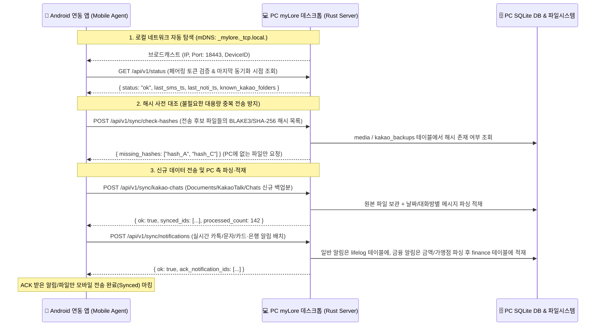

# myLore 모바일 연동 앱 설계 문서 (`연동앱설계.md`)

> **문서 목적**: 안드로이드 기반 동반 앱(**`myLore Mobile Agent`**, 구 `CamSender` 확장판)을 개발할 때 필요한 **모바일 앱 내부 설계**뿐만 아니라, **연동 상대방인 PC(`myLore` 데스크톱 앱)가 데이터를 수신한 뒤 내부적으로 어떻게 검증·파싱·적재·응답하는지(PC 측 동작 명세)**를 함께 정의하여 양측 개발의 정합성을 보장합니다.  
> **최종 수정일**: 2026-10-28

---

## 1. 전체 연동 아키텍처 개요 (End-to-End Architecture)



---

## 2. 연동 앱이 알아야 할 **PC(`myLore`) 측 내부 동작 원리**

안드로이드 연동 앱을 설계할 때, **"내가 보낸 데이터를 PC가 어떻게 처리하고 어떤 응답을 주는가?"**를 정확히 알아야 재전송(Retry), 중복 방지, 로컬 큐 삭제 시점을 올바르게 구현할 수 있습니다.

### 2.1 PC의 네트워크 대기 및 탐색 동작 (mDNS & HTTP Server)
- **항시 대기 데몬**: PC에서 `myLore`가 실행되면, `Rust` 백엔드가 로컬 포트(기본값 `18443`, 설정 변경 가능)에서 HTTP/HTTPS 수신 서버를 띄우고, 동시에 **mDNS (`_mylore._tcp.local.`)**로 자신의 IP와 포트를 공유기 내부망(LAN)에 브로드캐스트합니다.
- **연동 앱의 동작**:
  - 연동 앱은 안드로이드 `NsdManager`를 통해 `_mylore._tcp`를 탐색하여 IP가 바뀌어도 자동으로 PC를 찾습니다. (탐색 실패 시를 대비해 마지막 성공 IP 캐싱 및 수동 IP 입력 창 제공)
  - PC가 꺼져 있거나 외출 중(다른 네트워크)일 때 연동 앱은 에러를 띄우지 않고 **내부 SQLite(Room DB) 대기열에 데이터를 조용히 쌓아두었다가**, 집 Wi-Fi에 연결되어 PC 서버의 `/api/v1/status` 응답(`200 OK`)이 확인되는 즉시 일괄 전송(Flush)합니다.

### 2.2 PC의 중복 방지(Deduplication) 및 멱등성(Idempotency) 보장 원리
모바일 네트워크 특성상 전송 중 끊김으로 인해 **같은 데이터를 두 번 보내더라도 PC DB에 중복 데이터가 쌓이지 않도록** PC는 다음과 같이 동작합니다:
1. **파일(카톡 백업 텍스트, 사진/미디어) 해시 선(先) 검증**:
   - 모바일 앱이 파일을 무작정 업로드하기 전에 파일의 해시(`SHA-256` 또는 `BLAKE3`)와 파일 크기, 상대 경로를 `POST /api/v1/sync/check-hashes`로 먼저 보냅니다.
   - PC는 중앙 DB를 조회하여 **"아직 PC에 없는 해시 목록(`missing_hashes`)"만 응답**합니다. 모바일 앱은 이 목록에 포함된 파일만 실제 Multipart 업로드를 수행합니다.
2. **메시지/알림/금융 내역의 고유 해시 키(`dedup_key`) Upsert**:
   - PC는 수신된 각 카톡 대화 줄, 문자(SMS), 푸시 알림에 대해 `dedup_key = Hash(유형 + 발생시각_초단위 + 발신자/방이름 + 본문내용)`을 계산하고 SQLite의 `UNIQUE(dedup_key) ON CONFLICT IGNORE` 규칙으로 적재합니다.
   - 따라서 모바일 앱은 매일 밤 12시에 내보낸 카톡 대화 파일에 **어제까지의 이전 대화 내용이 함께 포함되어 있어도 전혀 신경 쓸 필요 없이 파일 통째로 보내면 됩니다.** PC 파서가 어제까지 이미 적재된 대화 줄은 자동으로 건너뛰고 **오늘 새로 추가된 대화 줄만 정확히 추출해 적재**합니다.

### 2.3 데이터 종류별 PC의 수신 후 내부 처리 파이프라인

#### ① 카카오톡 백업 폴더 (`Documents/KakaoTalk/Chats`) 수신 시 PC의 동작
- **수신 데이터**: `Chats/{대화방_날짜시간}/KakaoTalkChats.txt` 및 같은 폴더 내 이미지/미디어 파일들
- **PC의 처리 과정**:
  1. **원본 아카이빙**: 설정된 PC 백업 경로(예: `Data/_Backup/KakaoChats/{대화방}/`)에 원본 파일을 그대로 보존합니다.
  2. **날짜/메시지 파싱**: Rust 파서가 텍스트 파일 내의 날짜 구분선(예: `--------------- 2026년 10월 28일 수요일 ---------------`)을 기준으로 날짜 컨텍스트를 전환하며, 각 메시지(`[이름] [오후 3:12] 내용`)를 분해합니다.
  3. **DB 적재 및 일기 연동**: 파싱된 메시지를 `lifelog_messages` 테이블(`source = 'kakaotalk'`, `date = '2026-10-28'`)에 저장합니다. 사용자가 PC에서 `2026-10-28` 일기를 열면 우측 사이드바에 그날의 카톡 대화가 대화방별로 즉시 표시됩니다.
  4. **미디어 매칭**: 대화 본문에 사진 파일명(예: `KakaoTalk_20261028_...jpg`)이 언급되어 있고 같은 폴더에서 해당 사진이 함께 업로드되었다면, 사진을 `mylore://media/{uuid}`로 등록하고 메시지 레코드와 자동 연결합니다.

#### ② 카드/은행 알림 및 일반 푸시 알림 수신 시 PC의 동작
- **수신 데이터**: 안드로이드 `NotificationListenerService`가 수집한 JSON 배열 (`id`, `package_name`, `title`, `text`, ` sub_text`, `posted_at`)
- **PC의 처리 과정**:
  1. **패키지 분류**: `package_name`이 금융 앱(KB국민, 신한, 현대, 삼성, 우리, 하나, 농협, 카카오뱅크, 토스, 페이코 등)이거나 카드사 번호에서 온 SMS인지 판별합니다.
  2. **실시간 가계부 자동 파싱 (`finance_transactions` 테이블)**:
     - 정규식/패턴 파서가 알림 본문에서 **`[거래일시, 금융사/카드명, 승인/입금/출금/취소 여부, 금액(원), 가맹점/적요, 잔액/누적액]`**을 추출합니다.
     - 이때 DB에는 `verify_status = 'realtime'`(실시간 알림 적재 상태)으로 저장됩니다.
     - *(참고: 추후 사용자가 PC에서 은행/카드사 엑셀 파일을 넣으면, PC가 `[날짜 + 금액 + 가맹점]`을 대조하여 이미 알림으로 들어온 내역은 `verify_status = 'verified'`로 확정만 하고, 알림이 오지 않았던 자동이체·이자 내역만 새로 추가합니다.)*
  3. **일반 알림 적재**: 카톡/메시지/기타 앱 알림은 `lifelog_notifications` 테이블에 저장하여 당일 실시간 타임라인에 노출합니다.

#### ③ 휴대폰 사진/카메라 미디어 수신 시 PC의 동작
- **수신 데이터**: 이미지/영상 바이너리 + 모바일 측 메타데이터(`original_path`, `taken_at`, `sha256`)
- **PC의 처리 과정**:
  1. 파일 해시를 검증하고 고유 `UUID`를 발급합니다.
  2. 이미지의 **EXIF 촬영 일시(`DateTimeOriginal`)**를 읽어 해당 날짜(`YYYY-MM-DD`)의 **'미정리 미디어 인박스(`Media Inbox`)'** 상태로 등록합니다.
  3. 이후 사용자가 PC 앱의 일기나 프로젝트 문서로 사진을 드래그하여 본문에 삽입(`mylore://media/{uuid}`)하면 정식 `데이터(Archive)` 폴더로 이동되고, 인박스에서 삭제를 누르면 디스크에서 정리됩니다.

---

## 3. 안드로이드 연동 앱 (`myLore Mobile Agent`) 상세 설계

### 3.1 필수 권한 (Android Permissions)
개인용 데스크톱 연동 목적의 앱(사이드로딩 APK 설치)이므로 아래 권한들을 사용하여 제약 없는 자동화를 구현합니다:
1. **`MANAGE_EXTERNAL_STORAGE` (모든 파일 접근 권한)**:
   - `내장 저장공간 > Documents > KakaoTalk > Chats` 폴더 및 `DCIM/Camera`, `Pictures/KakaoTalk` 폴더를 별도의 파일 선택기 없이 백그라운드에서 직접 스캔·읽기 위해 필수입니다.
2. **`BIND_NOTIFICATION_LISTENER_SERVICE` (알림 접근 허용)**:
   - 은행/카드사 결제 푸시 알림 및 실시간 카톡/문자 알림을 백그라운드에서 즉시 캡처하기 위해 사용합니다.
3. **`READ_SMS` / `RECEIVE_SMS` (문자 메시지 읽기)**:
   - 카드 승인 문자, 은행 입출금 문자, 택배/인증/일반 문자를 누락 없이 동기화하기 위해 사용합니다.
4. **`INTERNET` / `ACCESS_NETWORK_STATE` / `ACCESS_WIFI_STATE` / `CHANGE_WIFI_MULTICAST_STATE`**:
   - 로컬 Wi-Fi에서 mDNS(`NsdManager`)로 PC `myLore` 서버를 찾고 데이터를 전송하기 위해 사용합니다.
5. **`CAMERA` (선택 — 기존 `CamSender` 기능 통합)**:
   - 책 스캔, 영수증, 서류 등을 찍자마자 스마트폰 저장공간에 남기지 않고(`cacheDir` 활용) PC `myLore` 인박스로 즉시 쏘아 보내는 빠른 스캔 카메라 기능입니다.

### 3.2 모바일 앱의 4대 핵심 모듈 구조
```text
app/src/main/java/com/mylore/mobile/
├── data/
│   ├── local/          # Room DB: 아직 PC로 전송되지 않은 알림/SMS 큐 및 전송 완료된 파일 해시 캐시
│   └── remote/         # OkHttp + Retrofit: PC myLore REST API 클라이언트
├── service/
│   ├── MyloreNotificationListener.kt  # 상단바 알림(카톡, 금융앱) 실시간 캡처 -> Room DB 저장
│   ├── KakaoChatFolderWatcher.kt      # Documents/KakaoTalk/Chats 스캔 및 신규 백업본 추출
│   └── DiscoveryAndSyncWorker.kt      # WorkManager 주기적/충전중/Wi-Fi 연결 시 PC 탐색 및 일괄 전송
└── ui/
    ├── MainActivity.kt                # 연결 상태(PC 온라인/오프라인), [지금 즉시 동기화] 버튼, 전송 로그
    └── QuickCamActivity.kt            # CamSender 통합: 영수증/문서 촬영 후 PC 인박스 즉시 전송
```

### 3.3 카카오톡 `Documents/KakaoTalk/Chats` 동기화 트리거 시나리오
1. **매일 밤 12시 백업 감시 (Auto-Sync)**:
   - 사용자가 밤 12시에 원격 조작 등으로 카톡 대화를 내보내면 `/storage/emulated/0/Documents/KakaoTalk/Chats/` 아래에 폴더(예: `KakaoTalk_Chats_2026-10-28_23-59-59/`)가 생성됩니다.
   - 연동 앱은 **① 매일 00:05 ~ 00:30 사이 주기적 백그라운드 작업(`WorkManager`)**, **② 충전기 연결 + 집 Wi-Fi 연결 시**, 또는 **③ 앱 내 `[지금 동기화]` 버튼 클릭 시** `Documents/KakaoTalk/Chats` 하위 파일들을 스캔합니다.
2. **증분 전송 및 선택적 정리**:
   - 스캔된 파일들의 해시를 PC `/api/v1/sync/check-hashes`에 조회하여 아직 PC에 백업되지 않은 파일만 업로드합니다.
   - PC로부터 `{ ok: true }` 응답을 받으면, 모바일 앱 설정(`"PC 백업 완료 후 휴대폰 내 Chats 임시 파일 자동 삭제 여부"`)에 따라 휴대폰 용량이 차지 않도록 오래된 백업 폴더를 정리할 수 있습니다.

---

## 4. PC ↔ 안드로이드 앱 간 REST API 명세 요약

PC의 `myLore`가 로컬 포트(기본 `http://{PC_LAN_IP}:18443`)로 제공하는 엔드포인트 규격입니다. 모든 요청 헤더에는 `X-MyLore-Token: {페어링_토큰}`이 포함됩니다.

| 메서드 & 경로 | 용도 | 요청 바디 (Request) | PC 응답 (Response) |
| :--- | :--- | :--- | :--- |
| `GET /api/v1/status` | PC 서버 생존 확인 및 마지막 동기화 타임스탬프 조회 | 없음 | `{ "ok": true, "pc_name": "MYLORE-PC", "version": "0.1.0", "last_sms_ts": 1761650000000 }` |
| `POST /api/v1/sync/check-hashes` | 파일 업로드 전 PC 보유 여부 확인 (중복 전송 방지) | `{ "hashes": ["blake3_hex_1", "blake3_hex_2"] }` | `{ "missing_hashes": ["blake3_hex_2"] }` |
| `POST /api/v1/sync/kakao-chats` | `Documents/KakaoTalk/Chats` 내 대화 텍스트 및 미디어 업로드 | ` multipart/form-data` (`folder_name`, `file`, `file_hash`, `modified_at`) | `{ "ok": true, "messages_added": 45, "media_uuid": "..." }` |
| `POST /api/v1/sync/notifications` | 수집된 상단바 알림(금융 결제 알림, 카톡 알림 등) 일괄 전송 | `{ "items": [{ "id": 1, "pkg": "com.kbcard...", "title": "...", "text": "...", "ts": 176165... }] }` | `{ "ok": true, "ack_ids": [1], "finance_parsed": 1 }` |
| `POST /api/v1/sync/sms` | 신규 수신/발신 문자 메시지 일괄 전송 | `{ "items": [{ "id": 10, "address": "1588...", "body": "...", "ts": 176165..., "type": "inbox" }] }` | `{ "ok": true, "ack_ids": [10], "finance_parsed": 1 }` |
| `POST /api/v1/sync/media` | 휴대폰 카메라 사진 및 `CamSender` 촬영본 전송 | `multipart/form-data` (`file`, `taken_at`, `source_type`: `"camera"` \| `"camsender"`) | `{ "ok": true, "uuid": "550e8400-...", "uri": "mylore://media/550e8400-..." }` |
